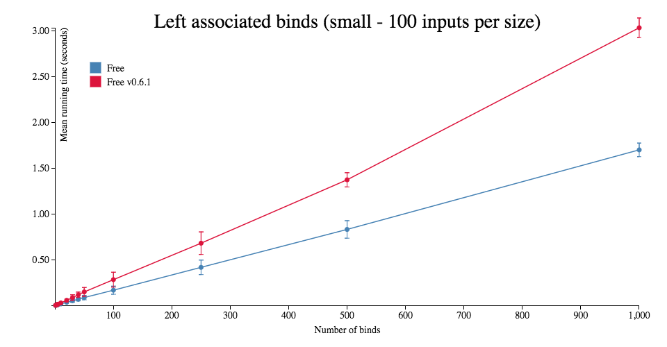
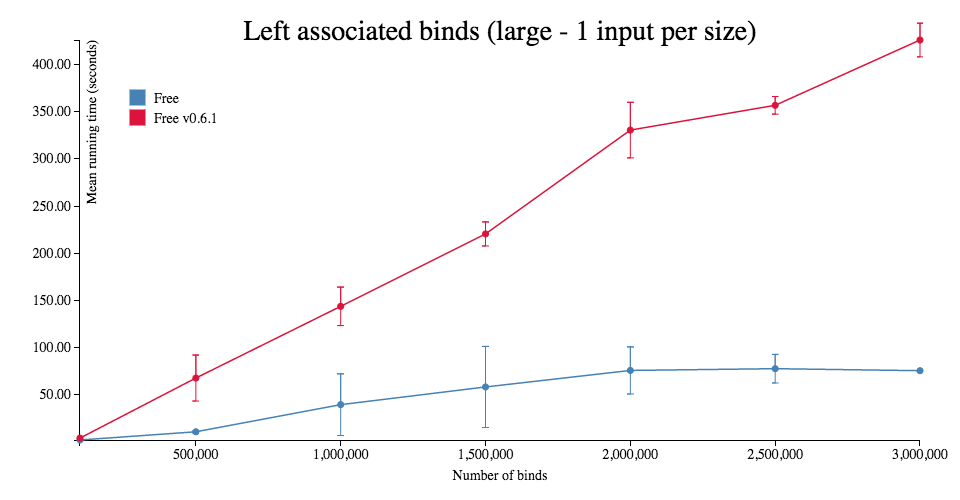
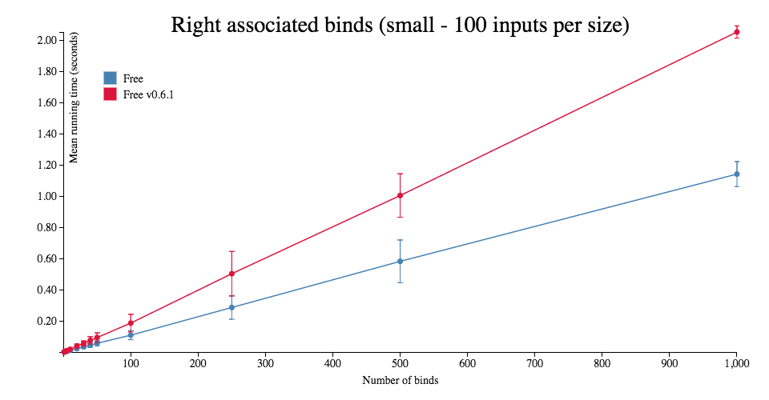
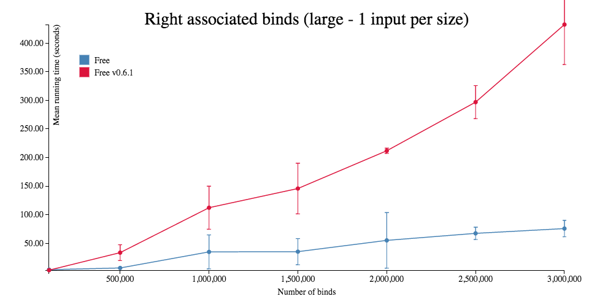

# purescript-free

[](https://github.com/purescript/purescript-free/releases)
[](https://github.com/purescript/purescript-free/actions?query=workflow%3ACI+branch%3Amaster)
[](https://pursuit.purescript.org/packages/purescript-free)

Free monad, Cofree comonad, Yoneda and Coyoneda functors, and the Trampoline monad implementations for PureScript.

The Free monad implementation is represented using a sequential data structure.

See the following reference for further information.

- [Reflection without Remorse](http://okmij.org/ftp/Haskell/zseq.pdf) (Ploeg and Kiselyov 2014)

## Installation

```
spago install free
```

## Documentation

Module documentation is [published on Pursuit](http://pursuit.purescript.org/packages/purescript-free).

## Benchmarks

Run `npm run build:benchmark` and `npm run test:benchmark` to run all four workloads.
The runner uses Minibench with garbage collection before each measurement series
and allows a 2.5 GiB old-generation Node heap for the three-million-bind cases.
To save JSON results, run
`npm run --silent test:benchmark > /tmp/free-benchmarks.json`; progress goes to stderr.
Timings include both bind construction and trampoline execution over each input
batch. Short cases group repeated batches to reduce timing noise. Results record
sample, warm-up and repetition counts, with timings normalized to seconds per
batch; the deviation and min/max describe these normalized samples.
The deterministic zero-array inputs and historical implementations are unchanged.
The sampling method differs from Benchotron, so these measurements are not directly
comparable to the historical results below.

The following benchmarks compare the implementation at `v5.2.0` (commit f686f5fc07766f3ca9abc83b47b6ad3da326759a) with the implementation at `v0.6.1` (commit 0df59c5d459fed983131856886fc3a4b43234f1f), which used the `Gosub` technique to defer monadic binds.








